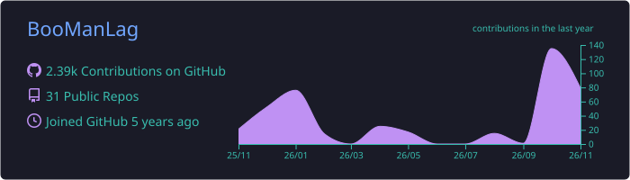
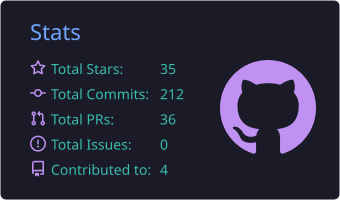
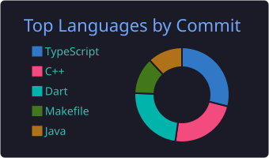
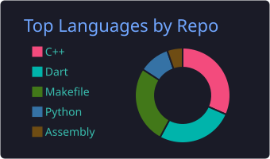
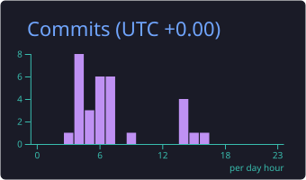

<!-- ===================== HEADER ===================== -->
<p align="center">
  
</p>

<p align="center">
  <a href="https://git.io/typing-svg">
    
  </a>
</p>

<p align="center">
  <a href="https://linkedin.com/in/joshuabumanlag"></a>
  <a href="https://twitter.com/boomanlag"></a>
  <a href="https://instagram.com/s1mplejoshuaa"></a>
  <a href="mailto:joshuabumanlagwork@gmail.com"></a>
  <a href="https://joshua-portfolio-gamma-ten.vercel.app/"></a>
</p>

<p align="center">
  
</p>

---

## 🧑‍💻 About Me

```dart
class Joshua extends Engineer {
  final role       = "Mobile Engineer @ ING Hubs PH";
  final community  = "Notion Ambassador";
  final askMeAbout = ["Flutter", "Firebase"];
  final learning   = ["Swift", "Native iOS", "More mobile goodness"];
  final funFact    = "I'm a startup & hackathon enthusiast 🚀";
}
```

- 📱 I build **mobile apps** that people actually enjoy using
- 🌱 Currently learning **Swift** and other mobile development languages
- 💬 Ask me about **Flutter** and **Firebase**
- 🗂️ Projects & experience → **[Check my portfolio here!](https://joshua-portfolio-gamma-ten.vercel.app/)**
- 📫 Reach me at **joshuabumanlagwork@gmail.com**

---

## 🛠️ Tech Stack

**📱 Mobile**


**🌐 Web & Languages**


**☁️ Backend, Cloud & Databases**


**🤖 ML, Data & Tooling**


---

## 📊 GitHub Stats

<p align="center">
  
</p>

<p align="center">
  
  
</p>

<p align="center">
  
  
</p>

<p align="center">
  
</p>

<p align="center">
  <picture>
    <source media="(prefers-color-scheme: dark)" srcset="https://raw.githubusercontent.com/BooManLag/BooManLag/output/github-snake-dark.svg" />
    
  </picture>
</p>

---

<p align="center">
  <b>⚡ Always down to build, hack, and ship something cool — let's connect!</b>
</p>

<p align="center">
  
</p>
